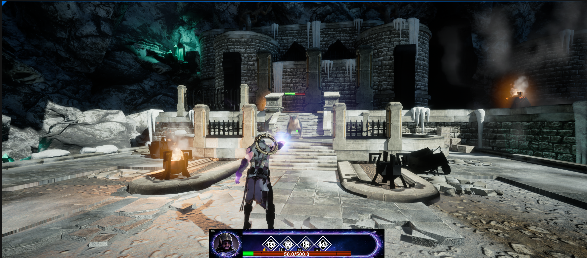
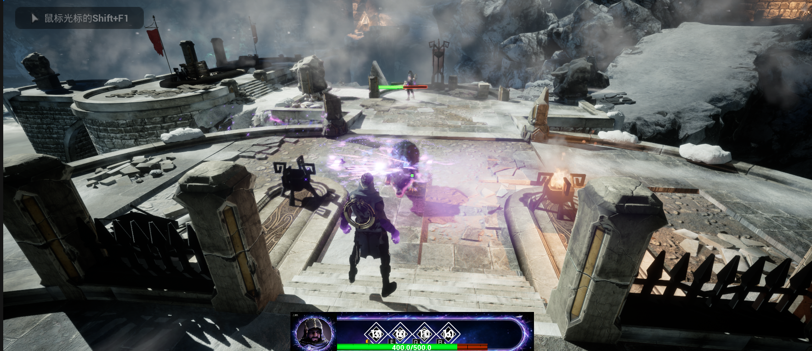
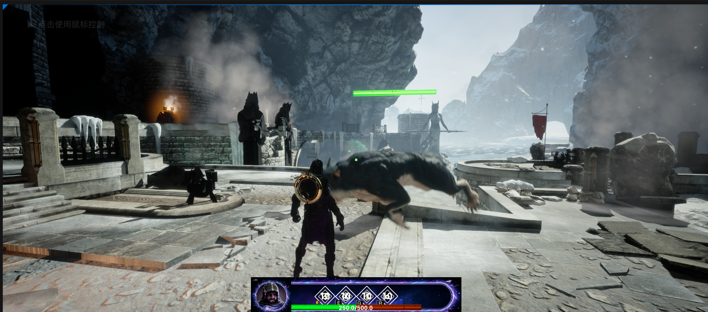
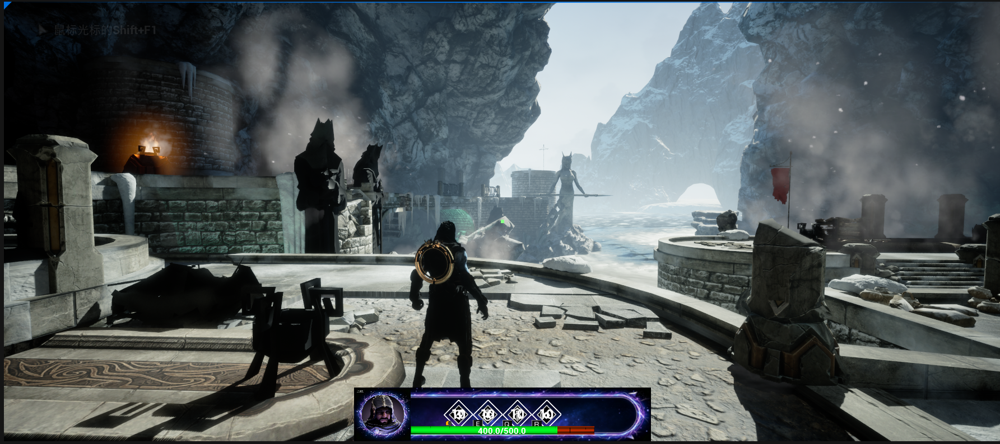

# FrozenCove — Third-Person Action Prototype (Unreal Engine 5.4)

A learning project I built in Unreal Engine 5.4 in summer 2026. I first built it by following a teacher's course, then rebuilt it again on my own to make sure I actually understood each system. It is **unfinished** — this repo documents what works so far and what I learned from building it.

## What's in This Repo

- `Gameproject.uproject` and `Config/` (the .uproject is currently associated with UE 5.5)
- `Content/maps` — the FrozenCove level, plus an early test map (map_01)
- `Content/BP`, `Content/framework`, `Content/anim` — gameplay Blueprints and animation assets
- `Content/UMG` — the HUD widgets (ability bar, health bar)
- Binary assets (.uasset / .umap) are stored with **Git LFS** — run `git lfs pull` after cloning to get the real files
- The Epic asset packs this project uses (Paragon Gideon & Shinbi, Starter Content, Infinity Blade Ice Lands) are **not included** for licensing reasons, so the project will have missing-asset references without them

## Current State

**Working:**
- Playable third-person character with basic (normal) attacks
- One AI-controlled enemy
- Player and enemy health bars
- Gameplay HUD in UMG: character portrait, health bar, and a four-slot ability bar

**Not yet implemented:**
- The four abilities are UI only — the skill icons and bar exist, but the skills do not fire in-game yet
- More enemy types, win/lose flow, and menus

## What I Learned

- UE5 project structure and level setup (the FrozenCove arena: snowy ruins environment, 840+ actors, blocking volumes for the playable space)
- UMG widget blueprints: building a HUD and wiring health values into progress bars
- Basics of AI controllers and character setup in Unreal

## Next Steps

- Implement the four abilities for real (input → gameplay effect → cooldown UI)
- Add enemy variety and a simple encounter/win condition

## Tech

- Unreal Engine 5.4, Blueprint
- Character/environment art: Epic Paragon assets & Starter Content (used under their license; not redistributed here)

## Screenshots

